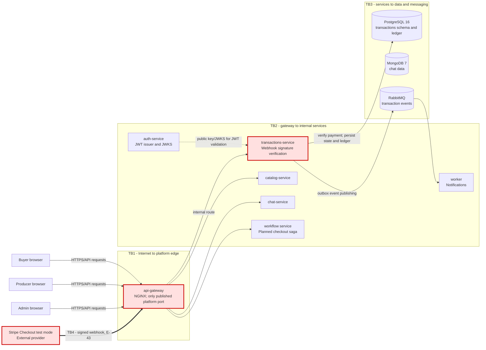

# CP1 - Attack Surface Map

## Scope and selected trust boundary

This map focuses on the Stripe test-mode payment webhook entering Market Agri through
`api-gateway` and reaching `transactions-service` (E-43). Stripe is an external, untrusted
caller. The webhook is not a buyer's browser request and must not be treated as authenticated
with a buyer JWT. The receiver must verify the payment provider's cryptographic signature.

## System and trust boundaries

TB4 is the selected boundary. The red path shows the external webhook flow. TB2 and TB3 provide
context for the receiver and its effects; they are not the primary scope of this checkpoint.
The workflow service is documented as a planned increment, so this map does not claim that its
checkout saga is currently deployed.

## Protected assets

| Asset | Classification | Security property at risk | Why it matters |
|---|---|---|---|
| Stripe webhook signing secret | Secret | Confidentiality | Disclosure could let an attacker forge webhook signatures. |
| Webhook payload and provider event ID | Restricted financial data | Integrity and authenticity | Forged, altered, or replayed events could change a transaction outcome. |
| `transactions` records in PostgreSQL | Restricted financial data | Integrity and availability | They represent payment state and must agree with the provider-confirmed result. |
| Ledger entries | Financial audit data | Integrity and non-repudiation | Duplicate or altered entries would undermine payment reconciliation. |
| Transactional outbox records and RabbitMQ events | Internal business data | Integrity and availability | Incorrect or duplicated events can trigger incorrect downstream processing. |
| Service credentials and database credentials | Secret | Confidentiality | Exposure could enable unauthorized service or data access. |
| Correlation and security logs | Internal operational data | Confidentiality and traceability | Logs help investigate webhook handling; they must not expose secrets or unnecessary personal data. |

## Entry points and existing controls

| Entry point | Caller and protocol | Authentication or validation in the design | Exposure |
|---|---|---|---|
| `POST /api/v1/transactions/webhooks/payment-gateway` (E-43) | Stripe test mode over HTTPS; a new inbound request | `transactions-service` verifies the provider's cryptographic signature before acting; transaction transitions and ledger writes are constrained by domain invariants. This route uses the provider signature, not a buyer JWT. | Enters through `api-gateway`; gateway is the only published platform port. |
| Gateway route to `transactions-service` | NGINX internal routing over the platform network | Dedicated webhook route; service performs signature verification. | Internal service network; service listens on port 8080 inside the network. |
| Transactions database access | `transactions-service` to PostgreSQL | Transactions service owns its schema; data access is through its service boundary. | PostgreSQL is internal and not the public webhook entry point. |
| Transaction event publication | Outbox relay to RabbitMQ | Transactional outbox and consumer idempotency are documented controls. | Broker is internal; it is not exposed as a public webhook endpoint. |

The local gateway setup documents host port 8000 mapped to gateway port 8080. Deployment port
mapping is environment-specific; only the gateway is intended to be published. TLS termination
at the gateway is documented as planned for a later step, so deployment configuration must be
checked before claiming HTTPS is already active in every environment.

## Initial attack-surface observations

- Stripe is outside the platform trust boundary; treat every webhook body and header as untrusted
  until signature and event validation succeed.
- The signature secret is a high-value secret and must remain server-side, outside source control,
  frontend bundles, and logs.
- A valid signature alone does not establish that an event is fresh or has not already been
  processed; replay handling and idempotency must be verified against the implementation.
- The project documents terminal transaction states and exactly-once ledger creation as design
  invariants. Confirm the actual implementation and tests before describing them as deployed
  controls.
- Webhook rate limiting, payload-size limits, safe error responses, and useful audit logging
  should be checked in the gateway and transactions-service implementation.

## Sources in the team documentation repository

- `05-architecture/security-threat-model.md` - trust boundaries and existing payment integration
  threats and controls.
- `05-architecture/overview.md` - gateway, services, stores, Stripe test mode, and webhook route.
- `07-api/api-contract.md` - E-43 payment webhook contract.
- `09-microservices/services/04-transactions-service/README.md` - service responsibilities,
  endpoint, database ownership, and event flow.
- `00-governance/security-policy.md` and `00-governance/security-rules.md` - secret handling,
  webhook signature verification, logging, and security controls.
